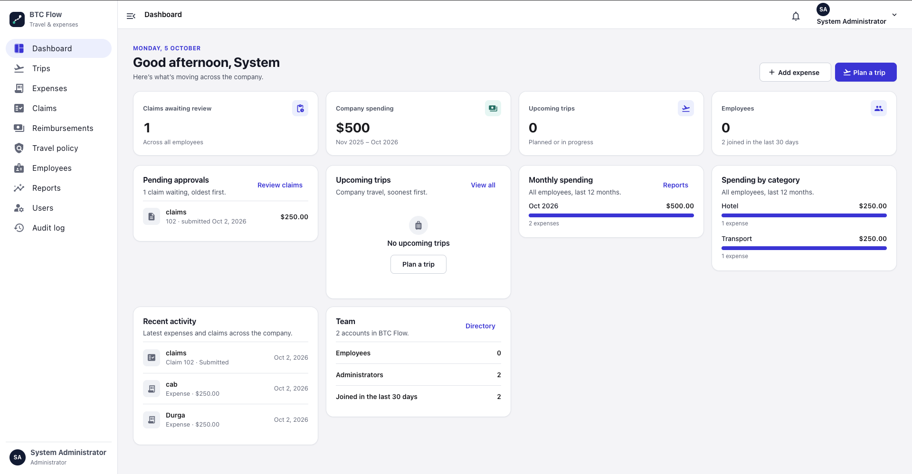
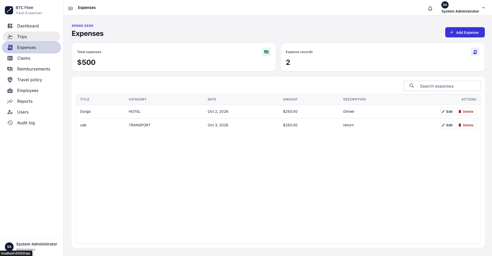
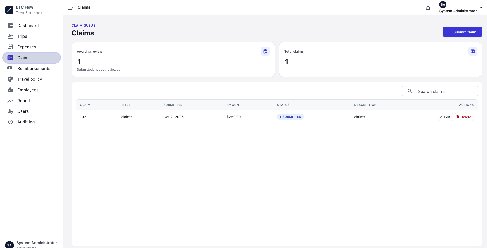
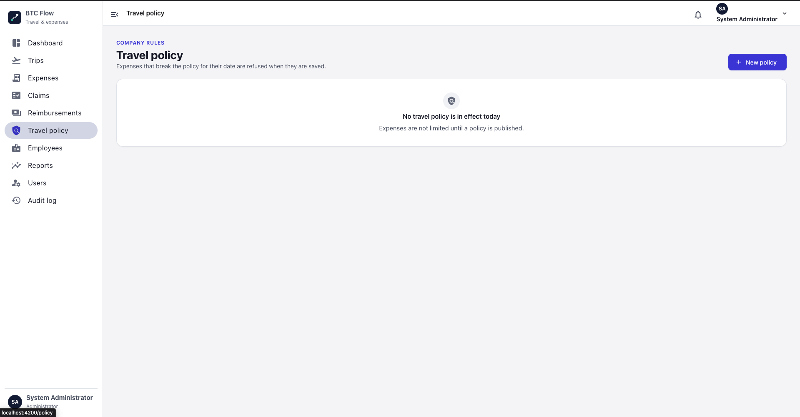
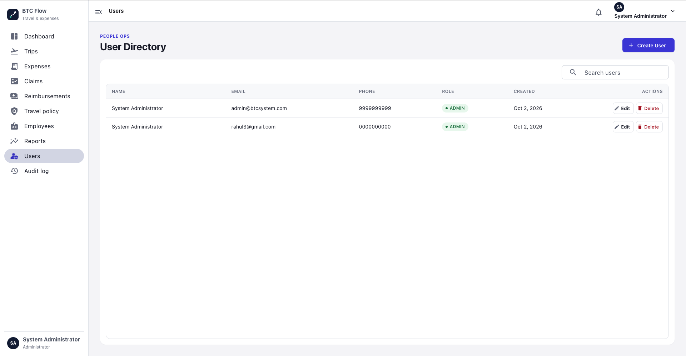

# BTC Microservices Project

A backend system built using **Java, Spring Boot, and Spring Cloud Microservices Architecture**. The project demonstrates how independent services communicate, discover each other, and manage centralized configuration through a distributed system.

## Application Screenshots

<table>
  <tr>
    <td align="center"><b>Dashboard</b></td>
    <td align="center"><b>Trip Management</b></td>
    <td align="center"><b>Expense Management</b></td>
  </tr>
  <tr>
    <td></td>
    <td></td>
    <td></td>
  </tr>
  <tr>
    <td align="center"><b>Claims Management</b></td>
    <td align="center"><b>Reimbursements</b></td>
    <td align="center"><b>Travel Policy</b></td>
  </tr>
  <tr>
    <td></td>
    <td></td>
    <td></td>
  </tr>
  <tr>
    <td align="center"><b>Employee Directory</b></td>
    <td align="center"><b>Reports & Analytics</b></td>
    <td align="center"><b>User Management</b></td>
  </tr>
  <tr>
    <td></td>
    <td></td>
    <td></td>
  </tr>
</table>

### Audit & Activity Tracking

  

## Architecture Overview

- **API Gateway** – Single entry point for client requests.
- **Service Registry (Eureka)** – Dynamic service discovery.
- **Config Server** – Centralized configuration management.
- **User Service** – User-related operations.
- **Trip Service** – Trip management.
- **Expense Service** – Expense tracking.
- **Payment Service** – Payment processing.
- **Notification Service** – Email/SMS notifications.
- **Claim Service** – Claim management and workflows.

## Tech Stack

- Java
- Spring Boot
- Spring Cloud
- Eureka Service Discovery
- Spring Cloud API Gateway
- REST APIs

## Architecture Workflow

1. Client requests enter through the API Gateway.
2. Services register with Eureka Server.
3. Services communicate through REST APIs.
4. Configuration is managed centrally through Config Server.

## How to Run the Project

1. Start Config Server.
2. Start Service Registry (Eureka).
3. Start the microservices.
4. Start API Gateway.
5. Access the services through the Gateway.

## Why I Built This

This project helped me gain practical experience with:

- Microservices architecture.
- Service-to-service communication.
- Centralized configuration.
- Service discovery.
- Building distributed backend applications.

## Future Improvements

- Add Docker support.
- Implement CI/CD pipelines.
- Improve logging and monitoring.
- Extend security with OAuth2 and JWT.

---

**Note:** This project is a learning-focused implementation designed to demonstrate practical microservices architecture and backend development concepts.
